<div align="center">

# 🩺 AstaWashe

### *Smart healthcare starts with every dose.*

**An AI-powered, audio-first medication reminder and health assistance platform for Ethiopia.**
*Built so no patient is left behind by what they can or can't see.*

<br>


<br>

[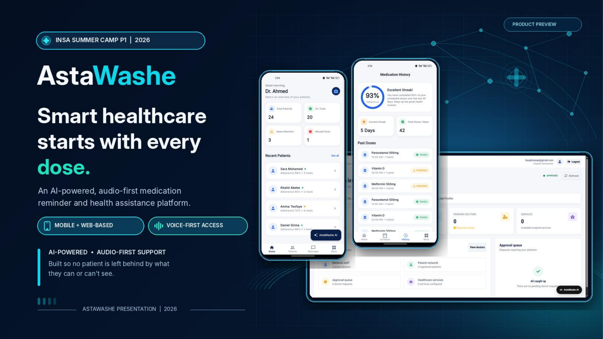](VIDEO_LINK_HERE)

**▶️ [Watch the 5-minute demo video](VIDEO_LINK_HERE)**

</div>

---

## 📑 Table of Contents

- [About the Project](#-about-the-project)
- [The Problem](#-the-problem)
- [Our Solution](#-our-solution)
- [Key Features](#-key-features)
- [Screenshots](#-screenshots)
- [How It Works](#-how-it-works)
- [System Architecture](#-system-architecture)
- [Tech Stack](#-tech-stack)
- [Roles & Permissions](#-roles--permissions)
- [Repository Structure](#-repository-structure)
- [Getting Started](#-getting-started)
- [Limitations](#-limitations)
- [Roadmap](#-roadmap)
- [Team](#-team)

---

## 🎯 About the Project

**AstaWashe** (አስታዋሽ — *"reminder"*) is a medication-management platform that connects **patients, caregivers, doctors, and hospitals** in one closed loop: from the reminder, through dose confirmation, to follow-up by the care team.

It was built for the **INSA Summer Camp PI 2026** with one mission:

> **Zero missed doses. Healthier communities. Lives saved.**

What makes it different is that it is **audio-first**. Every medication app assumes you can read a screen. AstaWashe speaks the reminder, listens for the confirmation, and keeps the care team informed — so blind, low-vision, elderly, and low-literacy patients get the same quality of care as everyone else.

---

## 🚨 The Problem

<div align="center">

| **5M+** | **38,000+** | **50%** | **30%+** |
|:---:|:---:|:---:|:---:|
| Ethiopians living with chronic illness | Health Extension Workers | of patients forget their medication | treatment drop-out rate for chronic illness |

</div>

- 👁️ **Screen-only tools leave people out.** Blind, low-vision, elderly, and low-literacy patients can't rely on small text and screen-heavy flows.
- 📞 **Manual follow-up doesn't scale.** Health workers spend hours making reminder calls by hand.
- 🕳️ **Missed doses go undetected** until they become a crisis, and there is no centralized way to track adherence.

> *Access should not depend on eyesight.*

---

## 💡 Our Solution

```
Patient  →  Medication  →  Reminder  →  Confirmation  →  Adherence  →  Care Team
```

A single platform where a reminder reaches the patient in the way they can actually receive it (voice, SMS, or app), the patient confirms with their voice or a keypress, and doctors and guardians see the result in real time — and are alerted automatically when doses are missed.

---

## ✨ Key Features

| | Feature | Description |
|---|---|---|
| 🔊 | **Audio-First Accessibility** | Spoken reminders and a voice-driven AI chat for blind, low-vision, and low-literacy patients. |
| 🔔 | **Smart Reminders** | Scheduled voice, SMS, and push reminders for every medication. |
| ✅ | **Voice & Keypress Confirmation** | Patients confirm doses by voice, with a keypress fallback in noisy settings. |
| 🤖 | **AI Health Assistant** | A multilingual chatbot (RAG over a curated health knowledge base) for 24/7 health questions. |
| 📊 | **Adherence Dashboard** | Real-time adherence rates, streaks, and risk flags for patients and doctors. |
| 💬 | **Doctor–Patient Link** | Direct messaging, prescriptions, and patient approval workflow. |
| 👨‍👩‍👧 | **Guardian Alerts** | Family members or doctors are notified automatically after **3 consecutive missed doses**. |
| 🏥 | **Hospital & Admin Portals** | Hospital registration/approval, doctor management, and system-wide oversight. |
| 🔐 | **Role-Based Access Control** | Five roles with auditable, least-privilege access. |
| 🌍 | **Multi-Language** | Amharic and English at launch; Afaan Oromo, Tigrigna, and Somali planned. |

### Implementation status

| Capability | Status |
|---|---|
| Patient, Doctor, Hospital Admin & System Admin apps | ✅ Working |
| Medication schedules, dose logging, adherence tracking | ✅ Working |
| Voice reminder & voice confirmation | ✅ Working |
| AI assistant (RAG + ChromaDB) | ✅ Working |
| Guardian / missed-dose alerts | ✅ Working |
| SMS, USSD & IVR channels | 🧪 Demonstration |
| Zero-internet (USSD-only) mode, national hospital integration | 🛣️ Roadmap |

---

## 📱 Screenshots

### Mobile apps (Flutter)

**Patient app** — today's doses, one-tap *Take Now*, schedule, history with adherence streak, and profile & language settings.

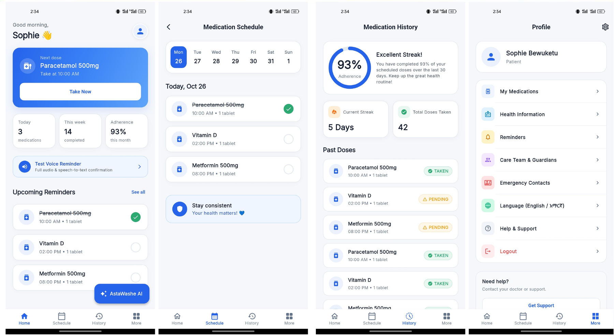

**Doctor app** — patient overview, adherence-based filtering, messaging, and prescription management.

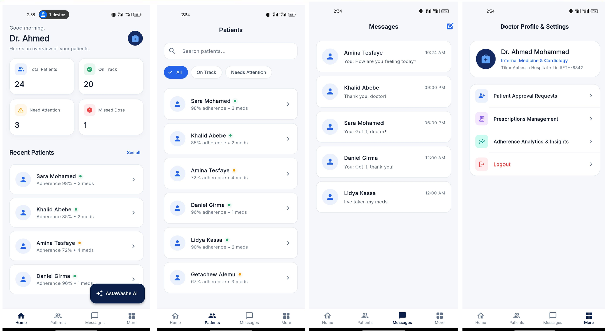

### Web portals (React + TypeScript)

<table>
<tr>
<td width="50%" align="center">
<b>Landing page</b><br>
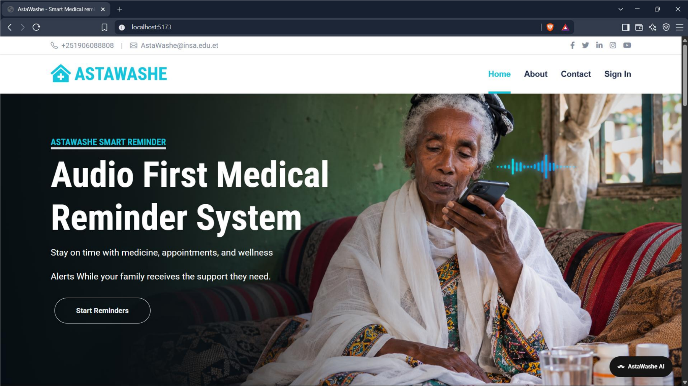
</td>
<td width="50%" align="center">
<b>Registration & sign-in</b><br>
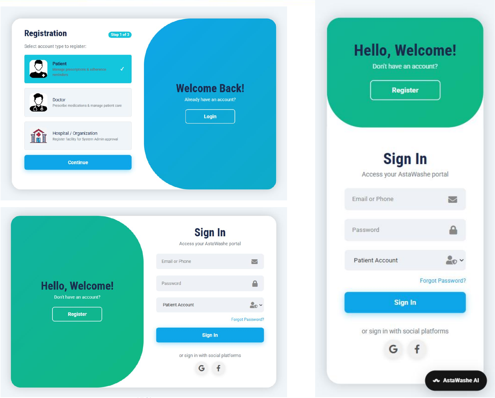
</td>
</tr>
<tr>
<td width="50%" align="center">
<b>Patient dashboard</b><br>
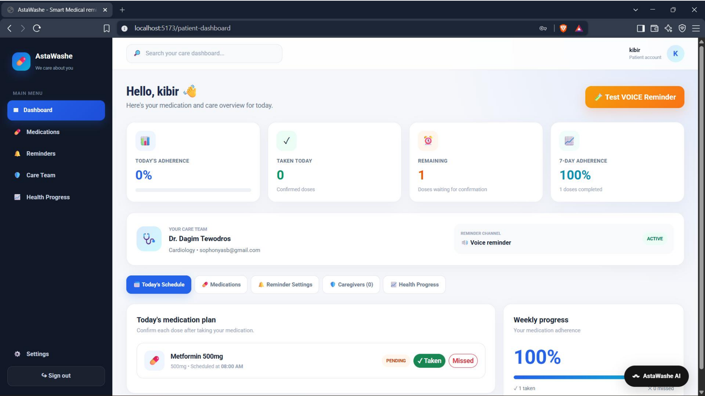
</td>
<td width="50%" align="center">
<b>Doctor dashboard</b><br>
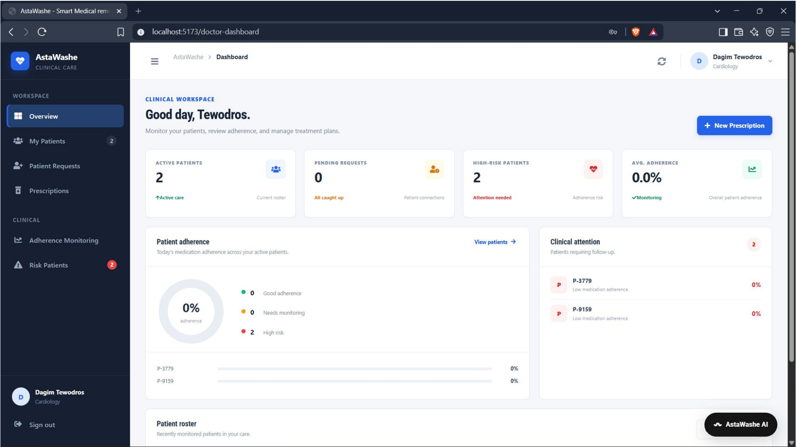
</td>
</tr>
<tr>
<td width="50%" align="center">
<b>Hospital admin dashboard</b><br>
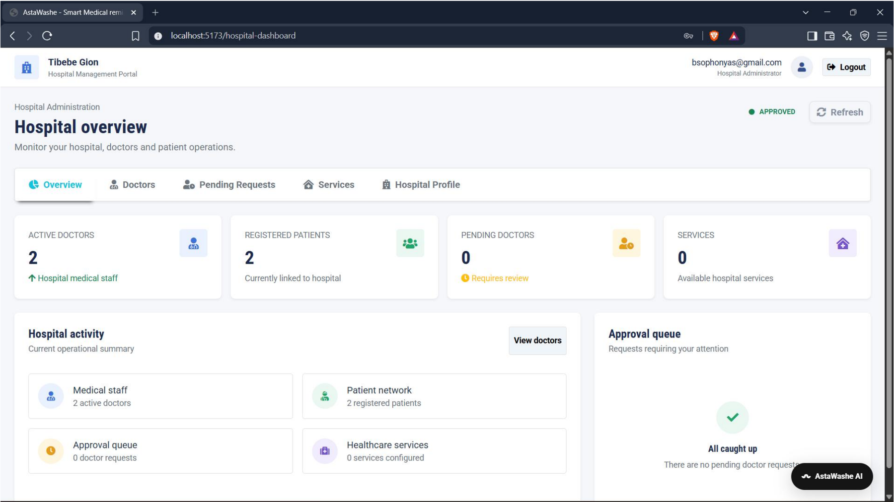
</td>
<td width="50%" align="center">
<b>System admin dashboard</b><br>
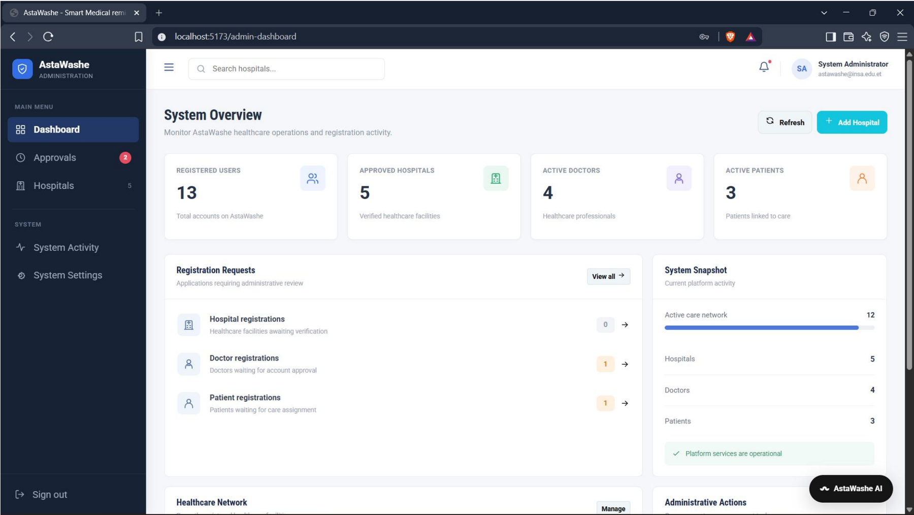
</td>
</tr>
</table>

---

## 🔄 How It Works

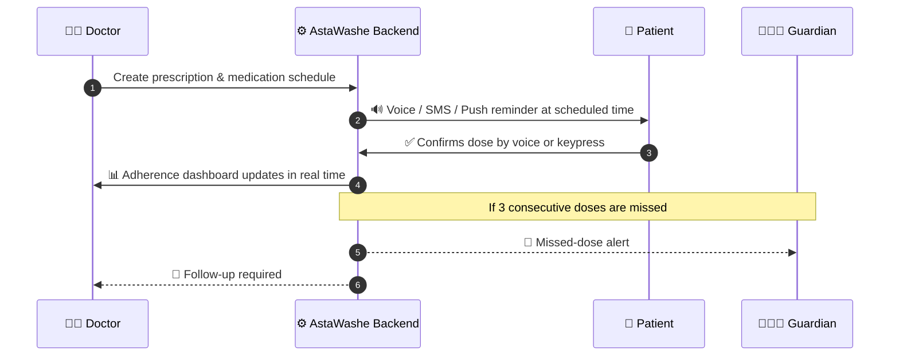

---

## 🏗️ System Architecture

AstaWashe uses a **dual-server architecture** connected through secure REST APIs, so the core platform and the AI services can be updated and scaled independently.

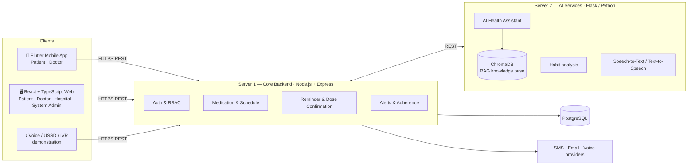

<details>
<summary><b>📐 Detailed architecture diagram</b></summary>
<br>

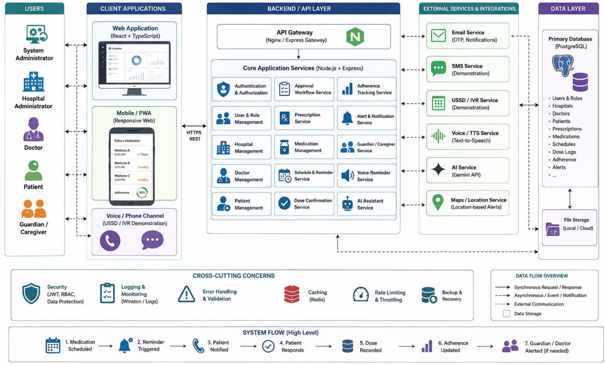

</details>

<details>
<summary><b>🗂️ Class diagram (data model)</b></summary>
<br>

Inheritance from `User` (Patient, Doctor, HospitalAdmin, SystemAdmin, Guardian); composition between Prescription, Medication, Schedule, DoseLog, and Adherence.

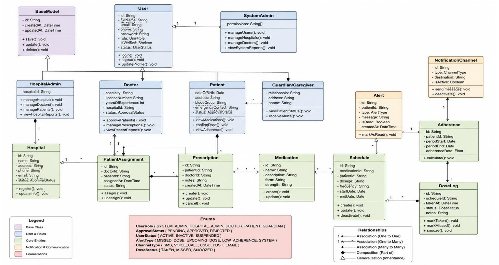

</details>

---

## 🧰 Tech Stack

| Layer | Technologies |
|---|---|
| **Mobile** | Flutter, Dart |
| **Web frontend** | React, TypeScript, Vite |
| **Core backend** | Node.js, Express, Prisma ORM |
| **AI services** | Python, Flask, ChromaDB, embeddings, RAG pipeline, Gemini API |
| **Voice** | Speech-to-Text & Text-to-Speech |
| **Database** | PostgreSQL |
| **Security** | JWT authentication, role-based access control, audit logging |
| **Notifications** | Push, SMS, Email, Voice (SMS/USSD/IVR in demonstration mode) |

---

## 🔐 Roles & Permissions

| Permission | System Admin | Hospital Admin | Doctor | Caregiver |
|---|:---:|:---:|:---:|:---:|
| Manage all hospitals & users | ✅ | – | – | – |
| Manage own hospital's staff | ✅ | ✅ | – | – |
| View adherence dashboards | ✅ | ✅ | ✅ | – |
| Message patients directly | – | – | ✅ | – |
| Receive missed-dose alerts | – | – | ✅ | ✅ |
| View system audit logs | ✅ | ✅ | – | – |

> Every privileged action is logged with a timestamp, actor, and affected record. Patients manage their own medications, reminders, and care team.

---

## 📂 Repository Structure

```
Astawashe_compiled/
├── astawashe_mobile/   # Flutter app — Patient & Doctor
├── frontend/           # React + TypeScript + Vite web portals
├── server1/            # Core backend — Node.js + Express + Prisma
├── Server2/            # AI services — Flask, ChromaDB, RAG
├── AudioAlert/         # Voice / audio reminder module
└── docs/               # Screenshots and diagrams
```

---

## 🚀 Getting Started

### Prerequisites

- Node.js 18+ and npm
- Python 3.10+
- PostgreSQL 14+
- Flutter 3.x (for the mobile app)

### 1. Clone

```bash
git clone https://github.com/SophyJR/Astawashe_compiled.git
cd Astawashe_compiled
```

### 2. Core backend (Server 1)

```bash
cd server1
npm install
cp .env.example .env          # set DATABASE_URL, JWT_SECRET, AI_SERVICE_URL, ...
npx prisma migrate dev
npm run dev
```

### 3. AI services (Server 2)

```bash
cd Server2
python -m venv venv && source venv/bin/activate    # Windows: venv\Scripts\activate
pip install -r requirements.txt
cp .env.example .env          # set GEMINI_API_KEY, ...
python app.py
```

### 4. Web frontend

```bash
cd frontend
npm install
npm run dev                   # http://localhost:5173
```

### 5. Mobile app

```bash
cd astawashe_mobile
flutter pub get
flutter run
```

> 🔑 Never commit real API keys or secrets. Use the `.env.example` files as templates.

---

## ⚠️ Limitations

We believe in an honest account of where AstaWashe stands today:

- **Internet dependency** — the full feature set needs connectivity; USSD/SMS-only mode is on the roadmap.
- **Voice recognition in noisy settings** — accuracy can drop; keypress confirmation is the fallback.
- **Two languages at launch** — Amharic and English; further languages need translation work.
- **Requires a registered phone number** — patients without phone access still depend on a caregiver or health-worker proxy.
- **Not a diagnostic tool** — the AI assistant supports adherence and general guidance and does **not** replace clinical diagnosis.
- **Pilot scope** — current testing is limited to a small patient group ahead of hospital integration.

---

## 🛣️ Roadmap

| Phase | Focus | Status |
|---|---|---|
| **Phase 1** | National hospital integration — deploy in major hospitals, government health-system API | 🔄 In progress — reached out to hospitals and started communication toward integration |
| **Phase 2** | Rural access — USSD/SMS-only mode, zero-internet functionality | 🛣️ Planned |
| **Phase 3** | Advanced AI — predictive health analytics, automated doctor referrals | 🛣️ Planned |
| **Phase 4** | Cross-platform mobile application (Flutter) | ✅ Completed after the summer camp |

**Vision:** become the standard digital health platform across Ethiopia and East Africa.

**Success targets:** 30%+ drop-out reduction · 90%+ adherence · 24/7 support · 4.5/5+ satisfaction.

---

## 👥 Team

**INSA Summer Camp PI 2026 — Project Contributors**

<div align="center">

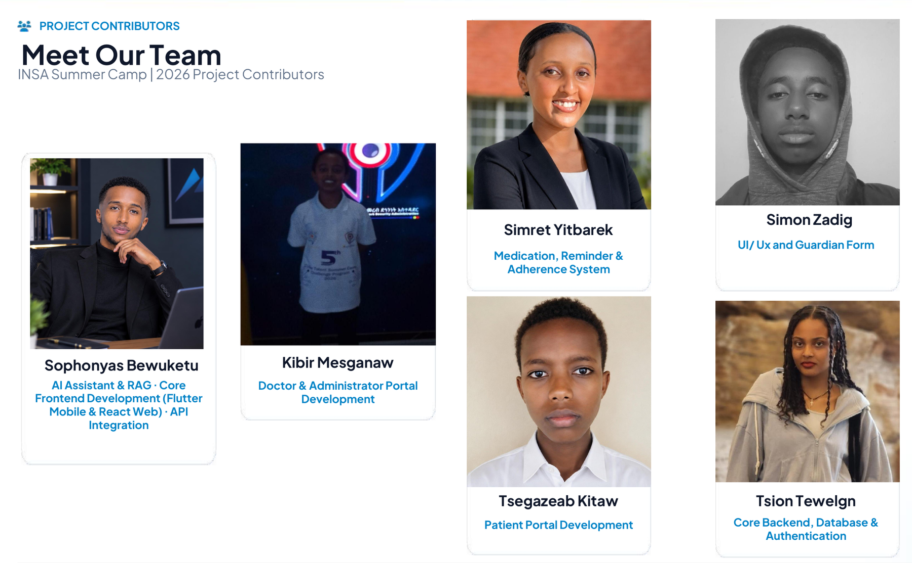

</div>

| Full Name | CTC ID | Role | GitHub |
|---|---|---|---|
| **Sophonyas Bewuketu** | `CTC-ID-HERE` | AI Assistant & RAG · Core Frontend (Flutter Mobile & React Web) · API Integration | [@SophyJR](https://github.com/SophyJR) |
| **Kibir Mesganaw** | `CTC-ID-HERE` | Doctor & Administrator Portal Development | [@kibirmesganaw-svg](https://github.com/kibirmesganaw-svg) |
| **Simret Yitbarek** | `CTC-ID-HERE` | Medication, Reminder & Adherence System | [@Simret-Y](https://github.com/Simret-Y) |
| **Simon Zadig** | `CTC-ID-HERE` | UI/UX & Guardian Form | [@siimonzaadig-git](https://github.com/siimonzaadig-git) |
| **Tsegazeab Kitaw** | `CTC-ID-HERE` | Patient Portal Development | [@tsegazeabkitaw844-glitch](https://github.com/tsegazeabkitaw844-glitch) |
| **Tsion Tewelgn** | `CTC-ID-HERE` | Core Backend, Database & Authentication | [@Tsion2107](https://github.com/Tsion2107) |

---:|---|---|---|---|
|  | **Sophonyas Bewuketu** | `CTC-ID-HERE` | AI Assistant & RAG · Core Frontend (Flutter Mobile & React Web) · API Integration | [@SophyJR](https://github.com/SophyJR) |
|  | **Kibir Mesganaw** | `CTC-ID-HERE` | Doctor & Administrator Portal Development | [@kibirmesganaw-svg](https://github.com/kibirmesganaw-svg) |
|  | **Simret Yitbarek** | `CTC-ID-HERE` | Medication, Reminder & Adherence System | [@Simret-Y](https://github.com/Simret-Y) |
|  | **Simon Zadig** | `CTC-ID-HERE` | UI/UX & Guardian Form | [@siimonzaadig-git](https://github.com/siimonzaadig-git) |
|  | **Tsegazeab Kitaw** | `CTC-ID-HERE` | Patient Portal Development | [@tsegazeabkitaw844-glitch](https://github.com/tsegazeabkitaw844-glitch) |
|  | **Tsion Tewelgn** | `CTC-ID-HERE` | Core Backend, Database & Authentication | [@Tsion2107](https://github.com/Tsion2107) |

---

## 🌿 Contributing

Branches follow `feature/<area>` (e.g. `feature/be-core`, `feature/be-ai-rag`, `feature/fe-core`, `feature/doctor-module`). Open a pull request into `main` — no direct pushes, please.

---

<div align="center">

**🩺 AstaWashe — Smart healthcare, for every patient. Heard, not just seen.**

*Built with ❤️ for the INSA Summer Camp PI 2026*

</div>
